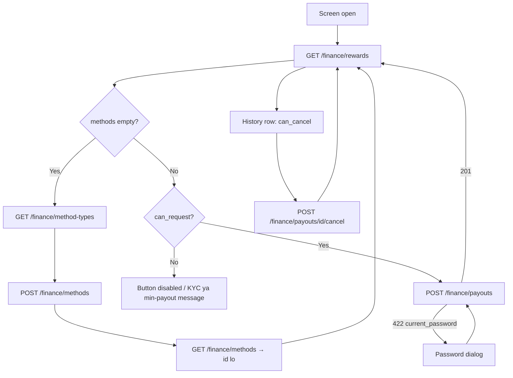

# Rewards & Payouts — Flutter API Guide

Client mobile API (`/api/v1`) ka poora **Rewards & Payouts** flow — jaisa web ke
`Money → Rewards & payouts` screen par dikhta hai. Har step ka API, request body
aur **real response** (local instance se live capture kiya hua) niche diya hai.

> Ye guide sirf is ek screen ke liye hai. Referral "Refer & earn" wale withdraw ka
> flow alag hai (`/api/v1/growth/referrals`) — wo is doc me nahi hai.

---

## Basics

- **Base URL:** `{{base_url}}/api/v1`
- **Auth:** har request me Sanctum token bhejo
  ```
  Authorization: Bearer <token>
  Accept: application/json
  Content-Type: application/json
  ```
- **Common envelope:** har response isi shape me aata hai —
  ```json
  { "success": true, "message": "...", "data": { }, "errors": null, "meta": null }
  ```
- **Errors:** validation fail par HTTP `422`, aur `errors` object me field-wise
  messages aate hain. Auth fail par `401`. Dusre user ka resource maangne par `404`.
- **Paisa:** har amount ke do form aate hain — formatted string (`"USD 50.00"`) aur
  raw integer minor units (`min_payout_minor: 5000` = 5000 cents = $50). Calculation
  ke liye hamesha `_minor` use karo, dikhane ke liye formatted string.

---

## Screen ki 8 APIs (quick reference)

| # | Method | Endpoint | Kaam |
|---|--------|----------|------|
| 1 | GET  | `/finance/rewards`               | Poora page data (tiles + history + methods + accounts) |
| 2 | GET  | `/finance/method-types`          | Admin ne kaunse payout rails set kiye (Bank/USDT/UPI) |
| 3 | GET  | `/finance/methods`               | User ke saved payout methods |
| 4 | POST | `/finance/methods`               | Naya payout method add |
| 5 | PUT  | `/finance/methods/{id}`          | Method edit |
| 6 | DELETE | `/finance/methods/{id}`        | Method delete |
| 7 | POST | `/finance/payouts`               | Payout (reward) request |
| 8 | POST | `/finance/payouts/{id}/cancel`   | Pending request cancel |

---

## Step 1 — Screen open: sab data ek call me

```
GET /api/v1/finance/rewards?status=all&page=1
```

Ye ek hi call tiles, history, saved methods aur account dropdown — sab de deta hai.

**Response (HTTP 200):**
```json
{
  "success": true,
  "message": "Success",
  "data": {
    "filters": { "status": "all" },
    "stats": {
      "available": "USD 0.00",   "available_minor": 0,
      "pending": "USD 0.00",     "pending_minor": 0,
      "paid": "USD 0.00",        "paid_minor": 0,
      "approved": "USD 0.00",    "approved_minor": 0,
      "methods": 0,
      "min_payout": "USD 50.00", "min_payout_minor": 5000,
      "can_request": false,
      "kyc_approved": false,
      "kyc_required": true,
      "kyc_threshold_minor": 0,
      "share_percent": 90,
      "cycle": null,
      "cap": null,
      "currency": "USD"
    },
    "methods": [],
    "accounts": [
      { "id": 362, "label": "Account 362 · challenge" },
      { "id": 3,   "label": "#2000002 · breached" }
    ],
    "eligibility": [],
    "payouts": [],
    "meta": { "current_page": 1, "per_page": 12, "total": 0, "total_pages": 1, "has_next": false }
  },
  "errors": null,
  "meta": null
}
```

**Field kaam:**

| Field | Kaam |
|-------|------|
| `stats.available` / `available_minor` | "Withdrawable" tile |
| `stats.pending` / `pending_minor`     | "Pending" tile |
| `stats.paid` / `paid_minor`           | "Disbursed" tile |
| `stats.min_payout_minor`              | Minimum request ($50 = 5000) |
| `stats.can_request`                   | `false` → "Request payout" button disabled |
| `stats.kyc_required` / `kyc_approved` | KYC gate (Step 3 dekho) |
| `stats.currency`                      | Saare `_minor` isi currency me |
| `methods`                             | Saved payout methods (Step 3 jaisa) |
| `accounts`                            | Payout request ka account dropdown (`id`, `label`) |
| `eligibility`                         | Har funded account ka profit / share / ab tak nikala gaya |
| `payouts` + `meta`                    | History list. Page me 12 rows. `meta.has_next` true → agla page load karo |

---

## Step 2 — History filter tabs

Same API, sirf `status` badlo:

```
GET /api/v1/finance/rewards?status=pending&page=1
```

`status` = `all` | `pending` | `approved` | `disbursed`. Response shape bilkul same,
bas `payouts` list filter ho jaati hai. Pagination `meta.has_next` se chalao.

---

## Step 3 — "Request payout" button ka logic

Step 1 ke `stats` se decide karo:

1. `can_request == false` → button **disabled** rakho.
   (Jaise balance `available_minor` < `min_payout_minor` ho.)
2. `kyc_required == true && kyc_approved == false` → KYC screen par bhejo, payout mat
   khulne do.
3. `methods` khaali (`[]`) → pehle Step 4 (add method) dikhao, phir payout.
4. Sab theek → Step 7 (request payout) enable.

---

## Step 4 — Payout method add karna

Pehle available rails lo:

```
GET /api/v1/finance/method-types
```

**Response (HTTP 200):**
```json
{
  "success": true,
  "message": "Payout method types fetched successfully",
  "data": {
    "method_types": [
      {
        "value": "bank",
        "label": "Bank transfer",
        "fields": [
          { "key": "bank_name",      "label": "Bank name",             "type": "text", "required": true },
          { "key": "account_name",   "label": "Account name",          "type": "text", "required": true },
          { "key": "account_number", "label": "Account number / IBAN", "type": "text", "required": true },
          { "key": "swift_ifsc",     "label": "SWIFT / IFSC",          "type": "text", "required": false }
        ]
      },
      {
        "value": "usdt",
        "label": "USDT (crypto)",
        "fields": [
          { "key": "network", "label": "Network",              "type": "text", "required": true, "placeholder": "TRC20" },
          { "key": "address", "label": "Wallet address",       "type": "text", "required": true },
          { "key": "memo",    "label": "Memo / tag (optional)","type": "text", "required": false }
        ]
      },
      {
        "value": "upi",
        "label": "UPI",
        "fields": [
          { "key": "upi_id",         "label": "UPI ID",         "type": "text", "required": true, "placeholder": "name@upi" },
          { "key": "account_holder", "label": "Account holder", "type": "text", "required": true }
        ]
      }
    ]
  },
  "errors": null,
  "meta": null
}
```

**Form dynamic banao:** user jo `value` (rail) chune, uske `fields` ka form dikhao.
Har field ka `key` hi request ke `details` object ki key banegi. `required` se
validation lagao. `placeholder` ho to hint dikhao.

Phir method save karo:

```
POST /api/v1/finance/methods
```
```json
{
  "type": "usdt",
  "label": "My USDT",
  "currency": "USD",
  "is_default": true,
  "details": { "network": "TRC20", "address": "TXXXXXXXXXXXXXXXXX" }
}
```

**Response (HTTP 201):**
```json
{ "success": true, "message": "Payout method saved.", "data": null, "errors": null, "meta": null }
```

> ⚠️ **Dhyan do:** ye API nayi method ki `id` nahi deti (`data: null`). Isliye save
> ke turant baad `GET /finance/methods` (ya `GET /finance/rewards`) dobara call karke
> id lo. Naya method seedha **active** banta hai — admin approval ka wait nahi.

```
GET /api/v1/finance/methods
```

**Response (HTTP 200):**
```json
{
  "success": true,
  "message": "Success",
  "data": {
    "methods": [
      { "id": 19, "label": "My USDT", "type": "usdt", "currency": "USD" }
    ]
  },
  "errors": null,
  "meta": null
}
```

---

## Step 5 — Payout (reward) request bhejna

```
POST /api/v1/finance/payouts
```
```json
{
  "amount": 100,
  "currency": "USD",
  "payout_method_id": 19,
  "trading_account_id": 362,
  "notes": "",
  "current_password": "secret123"
}
```

**Fields:**

| Field | Required? | Note |
|-------|-----------|------|
| `amount` | ✅ | 2 decimal tak. `min_payout_minor` se kam nahi |
| `currency` | ✅ | `stats.currency` wahi |
| `payout_method_id` | ✅ | user ka apna saved method |
| `trading_account_id` | ❌ | `accounts` dropdown se |
| `notes` | ❌ | max 500 chars |
| `current_password` | conditional | sirf tab jab user ne Security me "Withdrawal confirmation" ON kiya ho |

**`current_password` ka smart handling:** app ko pehle se pata nahi hota ki confirmation
ON hai ya nahi. Isliye pehle `current_password` ke bina bhejo. Agar niche wala 422 aaye,
to password dialog dikha kar `current_password` add karke dobara bhejo.

**Response — password chahiye (HTTP 422):**
```json
{
  "message": "Please confirm your password to request a withdrawal (you can turn this off under Settings → Security).",
  "errors": {
    "current_password": ["Please confirm your password to request a withdrawal (you can turn this off under Settings → Security)."]
  }
}
```

**Response — success (HTTP 201):**
```json
{ "success": true, "message": "Payout request submitted for review.", "data": null, "errors": null, "meta": null }
```

Success ke baad `GET /finance/rewards` refresh karo — tiles aur history update ho
jaayenge. Baaki validation errors (amount kam, KYC pending, method galat) bhi isi
`422 + errors{}` shape me aate hain.

---

## Step 6 — Pending request cancel karna

History row me `can_cancel == true` **sirf Pending** status par hota hai — wahi row
par Cancel button dikhao.

```
POST /api/v1/finance/payouts/{id}/cancel
```

**Response (HTTP 200):**
```json
{ "success": true, "message": "...", "data": null, "errors": null, "meta": null }
```

Success ke baad `GET /finance/rewards` refresh karo.

---

## Step 7 — Method edit / delete

**Edit:**
```
PUT /api/v1/finance/methods/{id}
```
```json
{
  "type": "usdt",
  "label": "My USDT edited",
  "currency": "USD",
  "details": { "network": "TRC20", "address": "TXXXXXXXXXXXXXXXXX" }
}
```
**Response (HTTP 200):**
```json
{ "success": true, "message": "Payout method updated.", "data": null, "errors": null, "meta": null }
```

**Delete:**
```
DELETE /api/v1/finance/methods/{id}
```
**Response (HTTP 200):**
```json
{ "success": true, "message": "Payout method removed.", "data": null, "errors": null, "meta": null }
```

Dono ke baad method list refresh karo. Dusre user ki method `id` bhejne par `404`.

---

## Poora flow (diagram)



---

## Verification note

Steps 1–4, 5 (422 password case), 7, 8 ke responses local instance
(`propfirmtest.com`) par live curl se capture kiye gaye hain. Payout request ka
**201 success** aur cancel ka response live capture nahi hue — unke liye KYC-approved
user + ek pending payout chahiye. Un dono ka shape upar diya common envelope hi hai.
